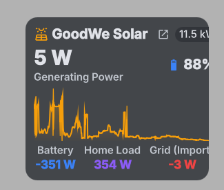

# GoodWe Solar & Battery Monitor for DankMaterialShell / Quickshell

Real-time local monitoring for GoodWe inverters with battery storage, designed for [DankMaterialShell (DMS)](https://github.com/AvengeMedia/DankMaterialShell) on Quickshell.



---

## Features

- **Direct LAN Connection**: Polls your GoodWe hybrid/string inverter locally via Modbus TCP (port 502) every 3 seconds. Zero cloud delay, no tokens, and immune to SEMS+ portal outages.
- **DankBar Status Bar Pill**: Compact display of solar generation (`☀️ 1.2 kW`), battery SOC (`🔋 60%`), and daily yield.
- **Interactive Popout**: Click the status bar pill to view live power flows (PV, Battery, House, Grid) with signed values (`+` charging / export, `-` discharging / import), inverter and battery temperatures, and a past 7 days generation bar chart.
- **4-Series Intra-day Canvas Graph**:
  - Solar PV generation (Amber area fill, themed via `Theme.warning`)
  - Home consumption / load (Themed via `Theme.secondary`)
  - Grid power (Themed via `Theme.info` with dynamic zero datum for import vs export)
  - Battery SoC % (Themed via `Theme.success` mapped to a dedicated 0–100% right Y-axis)
- **Control Center Integration**: Expandable detail tile in the DMS Control Center with power flow matrix, daily yield breakdown, and one-click launcher to your SEMS Portal account.
- **Desktop Widget Card**: A customizable desktop card (matching the `dankDesktopWeather` visual language) showing generation gauges, power flows, and daily yield.
- **Fault & Health Alarms**: Instant visual indicators for any inverter faults, battery errors, or connection dropouts.

---

## Architecture

1. **Collector Daemon (`poller.py`)**:
   A lightweight Python service that queries the inverter over LAN via Modbus TCP (port 502) and writes an atomic JSON snapshot to `${XDG_CACHE_HOME:-~/.cache}/goodwe_solar.json`. The daemon is shipped at the repository root and also bundled inside `plugins/goodweSolar2/poller.py` so standard registry installs include it.
2. **DMS Plugin (`plugins/goodweSolar2`)**:
   Provides the DankBar pill, popout dialog, and Control Center dropdown tile. Uses Quickshell's reactive `FileView` to reload immediately when the poller writes new telemetry, without running polling shell loops.
3. **Desktop Plugin (`plugins/goodweSolarDesktop`)**:
   Provides the desktop overlay widget card.

---

## Prerequisites

- Python 3.10+
- `goodwe` Python library (`pip install goodwe` or Nix package `python3Packages.goodwe`)
- DankMaterialShell (Quickshell) `>= 1.0.0`

---

## Installation & Setup

### 1. Install Plugin

#### Option A: Via DMS Plugin Registry

If installed via `dms plugins install goodweSolar2`, the plugin files (including `poller.py`) are placed in `~/.config/DankMaterialShell/plugins/goodweSolar2/`.

#### Option B: Manual Git Clone

```bash
git clone https://github.com/beobcode/goodwe-solar-dms.git ~/Projects/goodwe-solar-dms
cd ~/Projects/goodwe-solar-dms

mkdir -p ~/.config/DankMaterialShell/plugins/
cp -r plugins/goodweSolar2 ~/.config/DankMaterialShell/plugins/
cp -r plugins/goodweSolarDesktop ~/.config/DankMaterialShell/plugins/
```

---

### 2. Set Up Python Collector Daemon

The poller needs Python 3 and the `goodwe` library:

```bash
# If using a virtual environment:
cd ~/Projects/goodwe-solar-dms
python3 -m venv .venv
./.venv/bin/pip install --upgrade pip
./.venv/bin/pip install goodwe
```

Verify connection to your inverter by running a one-off query:

```bash
./.venv/bin/python3 poller.py --host <INVERTER_IP> --once
```

*(You will see a formatted JSON dump with live telemetry, battery SoC, and sensor readings.)*

---

### 3. Run Daemon Automatically (`systemd --user`)

Create a systemd user unit to keep telemetry running automatically in the background:

```bash
mkdir -p ~/.config/systemd/user
cat << 'EOF' > ~/.config/systemd/user/goodwe-solar.service
[Unit]
Description=GoodWe Solar Inverter Local Poller Daemon
After=network-online.target
Wants=network-online.target

[Service]
Type=simple
WorkingDirectory=%h/Projects/goodwe-solar-dms
Environment=GOODWE_INVERTER_IP=192.168.1.100
ExecStart=%h/Projects/goodwe-solar-dms/.venv/bin/python3 %h/Projects/goodwe-solar-dms/poller.py
Restart=always
RestartSec=5s

[Install]
WantedBy=default.target
EOF
```

> **Note:** Replace `192.168.1.100` above with your inverter's actual local IP address. If installed via registry, point `WorkingDirectory` and `ExecStart` to `~/.config/DankMaterialShell/plugins/goodweSolar2/poller.py`.

Enable and start the service:

```bash
systemctl --user daemon-reload
systemctl --user enable --now goodwe-solar.service
```

Check service status:

```bash
systemctl --user status goodwe-solar.service
```

---

### 4. Enable in DankMaterialShell

Reload plugins via DMS IPC:

```bash
dms ipc plugins reload goodweSolar2
dms ipc plugins reload goodweSolarDesktop
```

1. Open **DMS Settings** (`Mod + ,` or click Settings in DankBar).
2. Under **Control Center**, add `plugin_goodweSolar2` to your active widgets.
3. Under **Desktop Widgets**, add `goodweSolarDesktop` to place the solar card onto your desktop.

---

## Configuration & Environment Variables

The poller daemon supports the following environment variables (or CLI arguments):

| Environment Variable | CLI Argument | Default | Description |
| :--- | :--- | :--- | :--- |
| `GOODWE_INVERTER_IP` | `--host` | `192.168.1.100` | Inverter local IP address |
| `GOODWE_INVERTER_PORT` | `--port` | `502` | Modbus TCP port |
| `GOODWE_POLL_INTERVAL` | `--interval` | `3.0` | Poll interval in seconds |
| `GOODWE_OUTPUT_FILE` | `--output` | `${XDG_CACHE_HOME:-~/.cache}/goodwe_solar.json` | Telemetry JSON snapshot path |
| `GOODWE_HISTORY_FILE` | | `${XDG_CACHE_HOME:-~/.cache}/goodwe_solar_history.json` | Persistent daily history snapshot |

---

## Submitting to the Dux Plugin Registry

The official DankMaterialShell / Dux plugin repository index is maintained at [duxlabs-dev/dux-plugin-registry](https://github.com/duxlabs-dev/dux-plugin-registry).

Registry manifest `plugins/beobcode-goodwe-solar.json`:
```json
{
  "id": "goodweSolar2",
  "name": "GoodWe Solar & Battery",
  "category": "monitoring",
  "author": "Dominik",
  "description": "Real-time local GoodWe inverter telemetry, battery status, and power curves. Requires local background poller daemon (included) running with python3-goodwe.",
  "repo": "https://github.com/beobcode/goodwe-solar-dms",
  "path": "plugins/goodweSolar2",
  "screenshot": "https://raw.githubusercontent.com/beobcode/goodwe-solar-dms/main/screenshot.png",
  "capabilities": ["dankbar-widget", "control-center", "monitoring"],
  "dependencies": ["python3"]
}
```

---

## License

MIT
